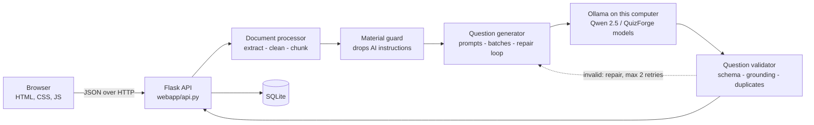

<div align="center">

# QuizForge

### Automatic MCQ Quiz Generator powered by a local, fine-tuned LLM

Turn notes, PDFs and documents into validated multiple-choice quizzes - **entirely on your own computer**.


</div>

> **Problem statement PS 97 - Automatic MCQ Quiz Generator.**
> Generate educationally useful multiple-choice questions from learning material using **Qwen 2.5 running locally through Ollama**,
> fine-tuned for this exact task. No OpenAI, Gemini, Claude, Groq or Hugging Face hosted inference is used anywhere, and no API key is needed.

---

## Contents
1. [Quick start for the team](#quick-start-for-the-team)
2. [Features](#features)
3. [The models](#the-models)
4. [How it works](#how-it-works)
5. [Architecture and API](#architecture-and-api)
6. [Configuration](#configuration)
7. [Validation: how answers are checked](#validation-how-answers-are-checked)
8. [Measuring LLM performance](#measuring-llm-performance)
9. [Fine-tuning](#fine-tuning)
10. [Project structure](#project-structure)
11. [Testing](#testing)
12. [Privacy and security](#privacy-and-security)
13. [Limitations and troubleshooting](#limitations-and-troubleshooting)

---

## Quick start for the team

You need **Windows 10/11**, about **10 GB of free disk space** and **8 GB of RAM** (16 GB for the Quality models).

| Step | What to do |
|---|---|
| 1 | Install **Python 3.11 or 3.12** from [python.org](https://www.python.org/downloads/). Tick **"Add python.exe to PATH"**. |
| 2 | Install **Ollama** from [ollama.com/download](https://ollama.com/download) and open it once. |
| 3 | Get the code: unzip `QuizForge.zip`, or `git clone https://github.com/Suketu-ADT/quizforge-mcq-generator.git`. |
| 4 | Copy the two fine-tuned model files (shared on the team Drive) into the **`model_files`** folder: `quizforge-3b.Q4_K_M.gguf` and `quizforge-7b.Q4_K_M.gguf`. Optional - without them the app uses the base models. |
| 5 | Double-click **`setup_models.bat`**. It asks before downloading each base model (`qwen2.5:3b` ~2 GB, `qwen2.5:7b` ~4.7 GB) and imports the fine-tuned files. |
| 6 | Double-click **`start.bat`**. The first run installs the Python packages; then the app opens at **<http://127.0.0.1:5000>**. Keep the black window open while you use it. |

The app picks the fine-tuned model automatically when it is installed. Switch models any time on the **Settings** page.

<details>
<summary>Manual setup (any operating system)</summary>

```powershell
python -m venv .venv
.venv\Scripts\Activate.ps1          # macOS/Linux: source .venv/bin/activate
pip install -r requirements.txt
ollama pull qwen2.5:3b              # optional: ollama pull qwen2.5:7b
python -m finetune.import_to_ollama --gguf model_files/quizforge-3b.Q4_K_M.gguf --name quizforge-3b --base qwen2.5:3b
python app.py                       # options: --port 5050 --no-browser --debug
```
</details>

## Features

| Area | What you get |
|---|---|
| **Input** | Drag and drop **PDF / DOCX / TXT** (type and size checked, scans and corrupt files handled) or paste text. The extracted text is shown for review first. Sentences that try to give orders to the AI are flagged before you generate. |
| **Generation** | 5 / 10 / 15 / 20 or a custom number (up to 50) of questions; Easy / Medium / Hard / Mixed; 2-6 options; Conceptual / Factual / Application / Mixed styles; optional instructions. |
| **Live and stoppable** | Questions stream in one by one as soon as they pass validation, with progress and elapsed time. **Stop** keeps everything produced so far. The job keeps running if you open another page. |
| **Model choice** | Four models: the two fine-tuned QuizForge models and the two base Qwen 2.5 models, switchable on the Generate page and in Settings. Models that are not installed cannot be chosen and Settings shows how to install them. |
| **Reliability** | JSON-schema constrained output, safe parsing, a bounded repair loop (never infinite), source-grounding check, duplicate detection (including two wordings of the same fact), names restored to the material's spelling (ReAct, BFS, Calvin). |
| **Answer-key double-check** | Optional: the model re-answers each question *without* seeing the key; disagreements get a "Review the key" badge. |
| **Human review** | Question cards: show/hide the answer, edit inline (re-validated by the server), regenerate one question, delete, add your own. |
| **Quiz mode** | One-at-a-time or all-on-one-page, instant feedback or exam mode, stopwatch or countdown, question palette, flag for review, submit confirmation, keyboard shortcuts (`A`-`F`, `1`-`6`, arrows, `M`), retake, **retry only the missed questions**. |
| **Never lose work** | Unsaved drafts are saved on the server, unfinished quizzes can be resumed, pasted material survives a page reload. |
| **Analytics** | Score trend, accuracy by topic and difficulty, attempt history and rule-based study recommendations from your real answers. |
| **Question bank** | Search and filter, rename, duplicate, edit, delete, export. |
| **Exports** | Question paper and answer key as **PDF** or HTML, answer key CSV, questions JSON/CSV with or without answers, results CSV/JSON. |
| **Polish** | Light and dark themes, responsive layout (phone to desktop), accessible focus styles and labels, reduced-motion support, no external fonts or scripts (works offline). |

## The models

| Name in the app | Ollama tag | Size | What it is |
|---|---|---|---|
| **Tuned Fast** (default when installed) | `quizforge-3b` | ~1.9 GB | Qwen 2.5 3B fine-tuned with QLoRA for this app |
| **Tuned Quality** | `quizforge-7b` | ~4.7 GB | Qwen 2.5 7B fine-tuned with QLoRA for this app |
| Fast | `qwen2.5:3b` | ~1.9 GB | Base model (also needed to import `quizforge-3b`) |
| Quality | `qwen2.5:7b` | ~4.7 GB | Base model (also needed to import `quizforge-7b`) |

Model tags are shown only on the Settings page; elsewhere the app uses the names in the first column.
Speed depends on your hardware (on a CPU-only laptop the 3B models write roughly 10-12 tokens/s).

## How it works



**Design principle:** the LLM only *writes candidates*. Everything that decides what is shown, stored or scored is ordinary code.
A generation runs as a background job on the server; the browser polls it every half second and shows each new question.

## Architecture and API

* **Front end** - `webapp/static/`: one `index.html`, one stylesheet and ES-module JavaScript (no framework, no build step). A hash router switches between seven pages (Dashboard, Generate Quiz, Question Bank, Take a Quiz, Analytics, Settings, About). All model and user text is inserted as text, never as HTML.
* **Back end** - `webapp/` (Flask, served by Waitress): a JSON API over the existing Python services. Flask was chosen over Django because the app is a small single-user API on top of existing services and SQLite: it needs no ORM, admin site or migrations.

| Endpoint | Purpose |
|---|---|
| `GET /api/status`, `GET/PUT /api/settings`, `POST /api/settings/test`, `POST /api/model` | Ollama status, model list, settings, model switch |
| `POST /api/extract`, `POST /api/material/check` | Read an uploaded file; counts and injection preview for the text box |
| `POST /api/generate`, `POST /api/check-keys`, `GET /api/jobs/<id>?since=n`, `POST /api/jobs/<id>/stop` | Background jobs: generation and answer-key checks |
| `POST /api/questions/validate`, `POST /api/questions/regenerate` | Re-check an edited question; rewrite one question |
| `GET/PUT/DELETE /api/draft`, `GET/PUT/DELETE /api/session` | Unsaved draft; unfinished quiz |
| `GET/POST /api/quizzes`, `GET/PUT/PATCH/DELETE /api/quizzes/<id>`, `POST /api/quizzes/<id>/duplicate` | Question bank |
| `GET /api/quizzes/<id>/export/<kind>`, `POST /api/export/<kind>` | PDF / HTML / CSV / JSON exports (saved quiz or draft) |
| `POST /api/quizzes/<id>/score`, `GET /api/attempts/<id>/export/<csv or json>`, `DELETE /api/attempts` | Scoring from the stored key, results export, clear history |
| `GET /api/dashboard`, `GET /api/analytics` | Dashboard numbers and analytics |

## Configuration
Settings come from environment variables (`.env`, created from `.env.example` by `start.bat`) and can be changed on the **Settings** page (saved in SQLite).

| Variable | Default | Meaning |
|---|---|---|
| `OLLAMA_BASE_URL` | `http://localhost:11434` | Ollama server |
| `OLLAMA_MODEL` | *(unset)* | Unset: the first installed of `quizforge-3b`, `qwen2.5:3b`, `quizforge-7b`, `qwen2.5:7b`. Set it to force a tag |
| `OLLAMA_TEMPERATURE` | `0.4` | Lower = more deterministic questions |
| `OLLAMA_TIMEOUT` | `300` | Seconds (applies between streamed chunks) |
| `MAX_INPUT_CHARS` | `60000` | Longer input is refused, never silently truncated |
| `MCQ_DB_PATH` | `data/quizzes.db` | SQLite file location |

## Validation: how answers are checked
Every model reply goes through `services/question_validator.py` before it can be shown:

1. **Safe parsing** - `json.loads` only (never `eval`); markdown fences stripped.
2. **Normalisation** - echoed `<material>` tags removed; options given as strings or a dict accepted; an answer given as option text is mapped to its letter. Nothing is invented.
3. **Schema (Pydantic)** - non-empty text; 2-6 options with unique ids and texts; `correct_answer` is a real option; valid difficulty; exact option count.
4. **Wording** - options not leaked into the question; no "statement + what?" echo questions; the answer is not given away.
5. **Grounding** - the quoted `source_excerpt` must appear in the source chunk (exact after normalising, or a contiguous match of at least 80%).
6. **Duplicates** - similar wording (Jaccard / sequence similarity of 0.82 or more) or the same fact asked twice (same answer from the same sentence, or a question asked in reverse).
7. **Optional double-check** - a blind re-answer by the model.

**What this does and does not prove:** it guarantees well-formed, grounded output. It **cannot prove the marked answer is correct** - that is why human review is part of the design.

**Prompt injection:** `services/material_guard.py` removes sentences in the material that give instructions to the AI ("ignore previous instructions", "reveal your system prompt", ...) before the model sees it, and refuses material that is nothing but such instructions.

## Measuring LLM performance
`run_evaluation.bat` (or `python evaluation/evaluate_llm.py --models qwen2.5:3b qwen2.5:7b`) runs three suites - a labelled 40-question answering test, a question-generation test on fixed passages and **12 performance metrics** (answer accuracy, F1, answer relevance, faithfulness, hallucination rate, instruction-following, safety attack success rate, task success rate, TTFT p95, end-to-end latency p95, cost per successful task, error rate) - and writes `evaluation/results/comparison_<time>.md`, every metric with its formula and worked calculation. `finetune\compare_finetuned.bat` compares each fine-tuned model with its base model using the same judge.
See [`evaluation/README.md`](evaluation/README.md) and [`docs/EVALUATION.md`](docs/EVALUATION.md).

## Fine-tuning
Both models were fine-tuned for this exact task with **QLoRA** (4-bit base + LoRA rank 16, Unsloth, one epoch on a free Kaggle T4 GPU) on SciQ, checked teacher questions and answer-check examples - all in the app's own prompt and JSON format - then exported to GGUF and run locally in Ollama. See [`finetune/README.md`](finetune/README.md).

## Project structure
```
quizforge-mcq-generator/
|-- app.py                   # starts the web app (Waitress) and opens the browser
|-- start.bat                # one-click launcher (Windows)
|-- setup_models.bat         # installs the base and fine-tuned models
|-- config.py                # settings, model list, defaults
|-- requirements.txt  .env.example  pytest.ini
|-- webapp/
|   |-- __init__.py          # Flask app factory, security headers
|   |-- api.py               # JSON API
|   |-- context.py           # settings, model status and catalogue
|   |-- jobs.py              # background generation / key-check jobs
|   `-- static/              # index.html, css/app.css, js/ (app, api, ui, charts, questions, pages/*)
|-- models/schemas.py        # Pydantic: Question, Quiz, Attempt, GenerationRequest
|-- services/
|   |-- ollama_client.py     # local HTTP client, streaming, status, errors
|   |-- document_processor.py# PDF/DOCX/TXT extraction and chunking
|   |-- material_guard.py    # removes instructions aimed at the AI
|   |-- question_generator.py# prompts, batching, bounded repair loop
|   |-- question_validator.py# parsing, validation, duplicates, casing
|   |-- answer_checker.py    # blind answer-key double-check
|   |-- quiz_service.py      # scoring and analytics
|   `-- export_service.py    # JSON, CSV, HTML, PDF
|-- database/                # SQLite connection and repository (parameterised SQL)
|-- evaluation/              # LLM evaluation (12 metrics with worked calculations)
|-- finetune/                # QLoRA notebook, data preparation, training, Ollama import
|-- model_files/             # put the fine-tuned .gguf files here (not in git)
|-- tests/                   # 381 tests (fake Ollama, Flask test client, one live test)
`-- docs/                    # evaluation guide and viva preparation
```

## Testing
```powershell
python -m pytest -q                                   # everything (the live test is skipped without Ollama)
python -m pytest -m "not integration"                 # offline tests only
python -m pytest tests/test_web_api.py -v             # the Flask API
```
**381 tests** cover validation rules, malformed model JSON, duplicates and casing, the prompt-injection guard, extraction and chunking, scoring, SQLite CRUD, exports, the Ollama client, generator retry bounds, the evaluation metrics, fine-tuning data preparation, and the whole web API with a fake model (generation jobs, Stop, key checks, quiz lifecycle, scoring, sessions, drafts, analytics, security headers).

## Privacy and security
- **No cloud AI.** Inference goes only to the configured Ollama URL; Settings warns if it is not on this computer. The server listens on `127.0.0.1` only.
- **Untrusted input.** Instructions hidden in uploads are removed before the model sees them; output must match a schema; **nothing returned by the model is ever executed**.
- **Safe rendering.** The front end inserts all text with `textContent`; a strict Content-Security-Policy allows only the app's own scripts and styles.
- **Safe exports.** CSV cells starting with `=`, `+`, `-`, `@` are neutralised; files are UTF-8 (with BOM for Excel).
- **Safe storage.** Parameterised SQL, transactions, upload type and size limits. No secrets are stored; `.env` is git-ignored.

## Limitations and troubleshooting
- A small model can still write a wrong answer key; automatic checks cannot guarantee correctness.
- Scanned PDFs need OCR, which is not included. Single-user local app without accounts.

| Problem | Fix |
|---|---|
| Sidebar shows **Ollama not running** | Open the Ollama app (or run `ollama serve`); check the URL in Settings |
| **Model not installed** | Run `setup_models.bat`, or pick an installed model in Settings |
| `setup_models.bat` says a `.gguf` file was not found | Copy the file from the team Drive into `model_files` with its exact name |
| Request timed out | Use a Fast model, fewer questions, or raise the timeout in Settings (the first call also loads the model) |
| Fewer questions than requested | Some candidates failed validation - press *Generate the remaining N* or use a Quality model |
| PDF has "no extractable text" | It is a scan; paste the text instead |
| Port 5000 is busy | `python app.py --port 5050` |
| `pip install` fails | Use Python 3.11 or 3.12 |

---
<div align="center">Built for the Generative AI jury - PS 97</div>
