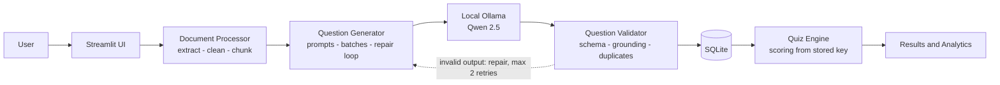
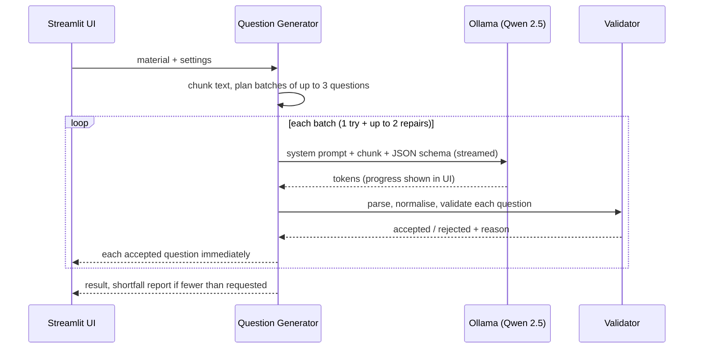

<div align="center">

# QuizForge

### Automatic MCQ Quiz Generator powered by a local LLM

Turn notes, PDFs and documents into validated multiple-choice quizzes - **entirely on your own machine**.


</div>

> **Problem statement PS 97 - Automatic MCQ Quiz Generator.**
> Generate educationally useful multiple-choice questions from learning material using **Qwen 2.5 running locally through Ollama**.
> No OpenAI, Gemini, Claude, Groq or Hugging Face hosted inference is used anywhere, and no API key is required.

---

## Table of contents
1. [Why this project](#why-this-project)
2. [Features](#features)
3. [How it works](#how-it-works)
4. [Quick start](#quick-start)
5. [Configuration](#configuration)
6. [Using the app](#using-the-app)
7. [Validation: how answers are checked](#validation-how-answers-are-checked)
8. [Measuring LLM performance](#measuring-llm-performance)
9. [Project structure](#project-structure)
10. [Testing](#testing)
11. [Privacy and security](#privacy-and-security)
12. [Limitations](#limitations)
13. [Roadmap](#roadmap)
14. [Troubleshooting](#troubleshooting)
15. [Further reading](#further-reading)

---

## Why this project
Writing good practice questions by hand is slow, and sending study material to a cloud AI raises privacy and cost concerns.
QuizForge keeps the whole pipeline local and treats the LLM as an **untrusted question writer**: the model proposes candidates, and ordinary deterministic code
parses, validates, de-duplicates, stores, scores and analyses them. A human reviews the result before it is used.

## Features

| Area | What you get |
|---|---|
| **Input** | Paste text or upload **PDF / DOCX / TXT** (type and size validated, scans and corrupt files handled). Extracted text is shown for review before anything is generated. |
| **Generation** | 5 / 10 / 15 / 20 or a custom number (up to 50) of questions; Easy / Medium / Hard / Mixed; 2-6 options; Conceptual / Factual / Application / Mixed styles; optional instructions. |
| **Live and stoppable** | Questions stream in one by one as soon as they pass validation. A **Stop** button keeps everything produced so far. |
| **Model switch** | Flip between **Fast** (`qwen2.5:3b`, default) and **Quality** (`qwen2.5:7b`) on the Settings page, or with the Fast / Quality toggle on Generate Quiz. Models that are not installed cannot be selected and show the exact `ollama pull` command. |
| **Reliability** | JSON-schema constrained output, safe parsing, a bounded repair loop (never infinite), source-grounding check and duplicate detection. |
| **Answer-key double-check** | Optional: the model re-answers each question *without* seeing the key; disagreements get a "review the key" badge. |
| **Human review** | Editable cards: edit, regenerate one question, delete, add manually. The correct answer stays hidden until revealed. Edits are re-validated. |
| **Quiz mode** | Clickable option cards with instant right/wrong feedback and animation (or exam mode with no reveal), question palette, flag for review, timer or countdown, submit confirmation, retake, restart, **retry only missed questions**, keyboard shortcuts. |
| **Never lose work** | Unsaved drafts auto-save to SQLite; unfinished quizzes can be resumed; the Dashboard shows "Continue" cards. |
| **Analytics** | Score, accuracy, per-topic and per-difficulty charts (Plotly), score trend, rule-based recommendations from your real answers. |
| **Question bank** | Search and filter, rename, duplicate, delete, edit, export. |
| **Exports** | Question paper and answer key as **PDF** or HTML, answer key CSV, questions JSON/CSV (with or without answers), results JSON/CSV. |
| **Polish** | Light and dark themes, first-run guide, responsive layout, accessible focus styles, reduced-motion support, one-click `start.bat`. |

## How it works



**Generation sequence**



**Design principle:** the LLM only *writes candidates*. Everything that decides what is shown, stored or scored is deterministic code.

## Quick start

### Prerequisites
- Windows 10/11 (the code is cross-platform; `start.bat` is Windows-only)
- **Python 3.11 or newer** (3.12 recommended)
- **[Ollama](https://ollama.com/download)** and at least one Qwen 2.5 model
- Enough RAM/VRAM for the model you choose (see the note below)

### 1. Install Ollama and pull a model
```powershell
ollama pull qwen2.5:3b      # default ("Fast")
ollama pull qwen2.5:7b      # optional ("Quality") - switch to it on the Settings page
```
Model library: <https://ollama.com/library/qwen2.5>. API docs: <https://docs.ollama.com/api>.

| Tag | Download size (approx.) | Notes |
|---|---|---|
| `qwen2.5:3b` | ~2 GB | **Default - "Fast".** Lightest and quickest; answer keys are less reliable |
| `qwen2.5:7b` | ~4.7 GB | **"Quality".** Slower, needs more RAM, noticeably better questions and keys |
| `qwen2.5:14b` | ~9 GB | Best quality, needs far more memory |

Speed and quality depend on your hardware; nothing here is a guarantee. (In development, `qwen2.5:3b` on a CPU-only laptop produced roughly 8-10 tokens/s.)

### 2. Run it

**Easiest (Windows):** double-click **`start.bat`**. It creates the virtual environment on first run, starts Ollama if needed and opens the app.

**Manually:**
```powershell
python -m venv .venv
.venv\Scripts\Activate.ps1
pip install -r requirements.txt
copy .env.example .env        # then edit OLLAMA_MODEL if needed
streamlit run app.py
```
Open <http://localhost:8501>. The app starts even if Ollama is not running; it shows *Disconnected* and explains what to do.

> **Honest privacy note:** your material is sent only to the Ollama endpoint you configure (default `http://localhost:11434`). Installing dependencies and the first model download need internet; generation afterwards runs locally. The app never downloads models by itself.

## Configuration
Settings come from environment variables (`.env`) and can be changed on the **Settings** page (saved in SQLite).

| Variable | Default | Meaning |
|---|---|---|
| `OLLAMA_BASE_URL` | `http://localhost:11434` | Ollama server |
| `OLLAMA_MODEL` | `qwen2.5:3b` | Starting model; any installed tag works. Switch Fast / Quality on the Settings page |
| `OLLAMA_TEMPERATURE` | `0.4` | Lower = more deterministic questions |
| `OLLAMA_TIMEOUT` | `300` | Seconds (applies between streamed chunks) |
| `MAX_INPUT_CHARS` | `60000` | Longer input is refused, never silently truncated |
| `MCQ_DB_PATH` | `data/quizzes.db` | SQLite file location |

The model tag is shown only on the Settings page; elsewhere the UI says "the local model". Themes switch from the three-dot menu (top right).

## Using the app
1. **Generate Quiz** - upload a file or paste text, choose count, difficulty and options, press *Generate*. Watch questions stream in; press *Stop* any time.
2. **Review** - reveal answers, edit, regenerate or delete questions. Optionally run *Double-check answer keys*.
3. **Save** to the question bank (or *Save and take quiz*).
4. **Take a Quiz** - click an option to see instantly whether it is right. Keyboard: `A`-`D` choose, `<-` `->` move, `M` flag.
5. **Results** - score, charts, recommendations and explanations; *Retry missed* builds a short quiz from your wrong answers.
6. **Export** the question paper and the answer key separately.

## Validation: how answers are checked
Every model reply goes through `services/question_validator.py` before it can be shown:

1. **Safe parsing** - `json.loads` only (never `eval`); markdown fences stripped.
2. **Normalisation** - echoed `<material>` tags removed; options given as strings or a dict accepted; an answer given as option text is mapped to its letter. Nothing is invented.
3. **Schema (Pydantic)** - non-empty text; 2-6 options with unique ids and unique texts; `correct_answer` references a real option; difficulty is Easy, Medium or Hard; exact configured option count.
4. **Options not inside the question text** (regex check).
5. **Grounding** - the quoted `source_excerpt` must appear in the source chunk: an exact match after normalising case, quotes and whitespace, or a contiguous match covering at least 80% (`difflib`).
6. **Duplicates** - word-set (Jaccard) or sequence similarity of at least 0.82 against existing questions.
7. **Optional double-check** - a blind re-answer by the model (see above).

**What this does and does not prove:** it guarantees well-formed, grounded output. It **cannot prove the marked answer is correct** - a small model can still pick the wrong option. That is why human review is part of the design.

## Measuring LLM performance
Use the same fixed test set (for example 3 documents x 10 questions) on each model and report hardware and settings.

| Metric | Formula | Where it comes from |
|---|---|---|
| Tokens per second | `eval_count / (eval_duration / 1e9)` | Ollama's response fields |
| Seconds per accepted question | `total generation time / accepted questions` | Measured |
| Acceptance rate | `accepted / (accepted + rejected)` | Validator counts |
| Valid-JSON rate | `parsed replies / total replies` | Parser |
| Grounding rate | `questions with a verified quote / questions with a quote` | Validator |
| **Key accuracy** | `keys a human judges correct / keys reviewed` | **Human labelling** (no tool can compute this) |
| Self-consistency | `"agrees" / questions checked` | Double-check pass |

Sample observations from development (`qwen2.5:3b`, CPU only, small samples - not a benchmark): about 8-10 tokens/s; one run produced 4 valid questions in ~124 s; one 10-question run yielded 8 valid questions from 22 candidates (acceptance about 36%).
Quiz accuracy (`correct / total x 100`) measures the *student*, not the model.

**Run the evaluation yourself:** `python evaluation/evaluate_llm.py --models qwen2.5:3b qwen2.5:7b` gives each model a labelled 40-question test and prints
Accuracy, Exact Match, Precision, Recall, F1 (macro / micro / weighted), Top-k, MCC, Cohen's kappa, log loss, Brier score and ECE **with every calculation shown**.
See [`evaluation/README.md`](evaluation/README.md) for how each metric is computed and how to explain it.

### The 12 performance metrics
Double-click `run_evaluation.bat`: it runs all tests on both models (each judged by the other) and writes
`evaluation/results/comparison_<time>.md` plus a report per model. Besides the two tests above it measures Answer Accuracy, F1,
Answer Relevance, Faithfulness, Hallucination Rate, Instruction-Following, Safety Attack Success Rate, Task Success Rate,
TTFT p95, End-to-End Latency p95, Cost per Successful Task and Error Rate - each with its formula, the worked calculation,
sample count and an explicit status when it cannot be computed (`n/a`, never a made-up number).
Full reference: [`docs/EVALUATION.md`](docs/EVALUATION.md).

## Project structure
```
quizforge-mcq-generator/
|-- app.py                     # Streamlit entry point and navigation
|-- config.py                  # Environment settings and defaults
|-- start.bat                  # One-click launcher (Windows)
|-- requirements.txt  .env.example  pytest.ini  .gitignore
|-- .streamlit/config.toml     # Light and dark themes
|-- models/
|   `-- schemas.py             # Pydantic: Question, Quiz, Attempt, GenerationRequest
|-- services/
|   |-- ollama_client.py       # Local HTTP client, streaming, status, errors
|   |-- document_processor.py  # PDF/DOCX/TXT extraction and chunking
|   |-- question_generator.py  # Prompts, batching, bounded repair loop
|   |-- question_validator.py  # Parsing, normalisation, validation, duplicates
|   |-- answer_checker.py      # Optional blind answer-key double-check
|   |-- quiz_service.py        # QuizSession, scoring, analytics
|   `-- export_service.py      # JSON, CSV, HTML, PDF
|-- database/
|   |-- db.py                  # Connections, transactions, schema
|   `-- repository.py          # All SQL (parameterised)
|-- pages/                     # Dashboard, Generate, Question Bank, Quiz, Analytics, Settings, About
|-- components/                # CSS/themes, sidebar, question cards, charts, downloads
|-- evaluation/                # LLM performance evaluation (metrics with worked calculations)
|-- tests/                     # 178 tests (mocked Ollama, headless UI, one live test)
|-- docs/VIVA_PREP.md          # Jury questions and answers
`-- data/                      # SQLite database lives here (git-ignored)
```

## Testing
```powershell
python -m pytest -v                          # everything (the live test is skipped if Ollama is not running)
python -m pytest -m "not integration"        # offline tests only
python -m pytest tests/test_integration_ollama.py -v -m integration   # live Qwen test
```
**178 tests** cover: schema and validation rules, malformed model JSON, duplicate detection, extraction and chunking, scoring (including unanswered questions, retakes and reset), SQLite CRUD and rollback, exports (JSON, CSV, HTML, PDF), the Ollama client (unavailable, timeout, missing model, streaming), generator retry bounds, and headless UI flows with Streamlit's `AppTest` (submit, resume, Stop, draft restore, retry-missed). Ollama is mocked in the unit tests, so no model is needed.

## Privacy and security
- **No cloud AI.** Inference goes only to the configured Ollama URL; the Settings page warns if it is not on this computer.
- **Untrusted input.** Uploaded and pasted text may contain instructions; it is delimited as data, the system prompt says to ignore instructions inside it, output must match a schema, and **nothing returned by the model is ever executed**.
- **Safe rendering.** All model and user text is HTML-escaped; button labels are escaped for markdown/LaTeX.
- **Safe exports.** CSV cells starting with `=`, `+`, `-`, `@` are neutralised; files are UTF-8 (with BOM for Excel).
- **Safe storage.** Parameterised SQL, transactions, upload type/size limits. No secrets are stored; `.env` is git-ignored.

## Limitations
- A small model can write wrong or ambiguous answer keys; automatic checks cannot guarantee correctness.
- Scanned PDFs need OCR, which is not included.
- Speed and quality depend on your hardware and model size.
- Single-user local app; there is no authentication.

## Roadmap
OCR for scanned documents - more question types (multi-select, true/false, fill-in) - spaced repetition - multi-user mode - local embeddings for retrieval over very large documents - a built-in benchmark page for model comparison.

## Troubleshooting
| Problem | Fix |
|---|---|
| Sidebar shows **Disconnected** | Start Ollama (app or `ollama serve`); check the URL in Settings; test `curl http://localhost:11434/api/tags` |
| "The selected AI model is not installed" | Run `ollama pull <tag>` (Settings shows the command) or choose an installed model |
| Request timed out | Use a smaller model, fewer questions, or raise the timeout in Settings (the first call also loads the model) |
| Fewer questions than requested | The validator rejected invalid or ungrounded ones - use *Generate the remaining N* or a larger model |
| PDF has "no extractable text" | It is a scan; paste the text instead |
| `pip install` fails on the newest Python | Use Python 3.11 or 3.12 for the virtual environment |
| `Activate.ps1` is blocked | `Set-ExecutionPolicy -Scope CurrentUser RemoteSigned` |

## Further reading
- [`docs/VIVA_PREP.md`](docs/VIVA_PREP.md) - jury questions and model answers.
- [Ollama API documentation](https://docs.ollama.com/api) - [Qwen 2.5 on Ollama](https://ollama.com/library/qwen2.5)

---
<div align="center">Built for the Generative AI jury - PS 97</div>
